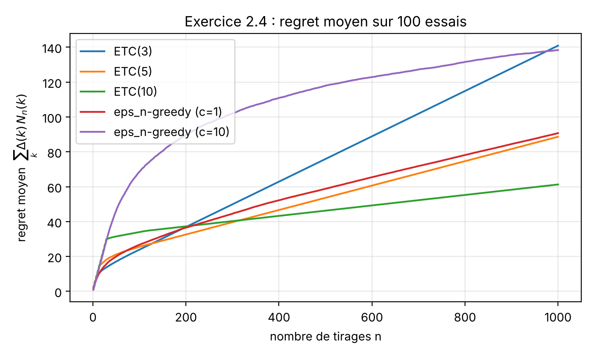
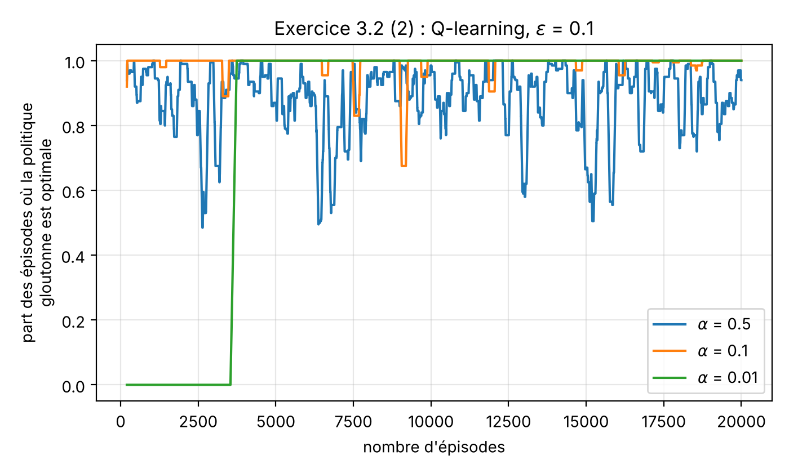
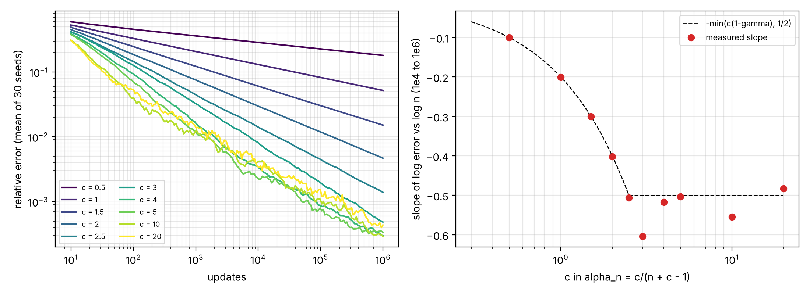
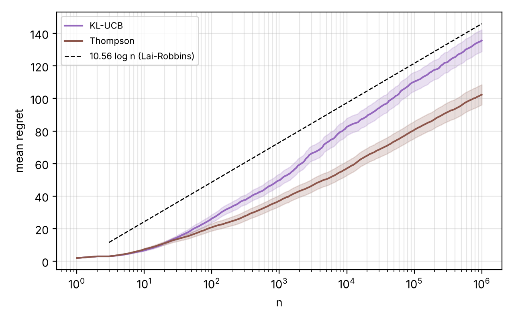
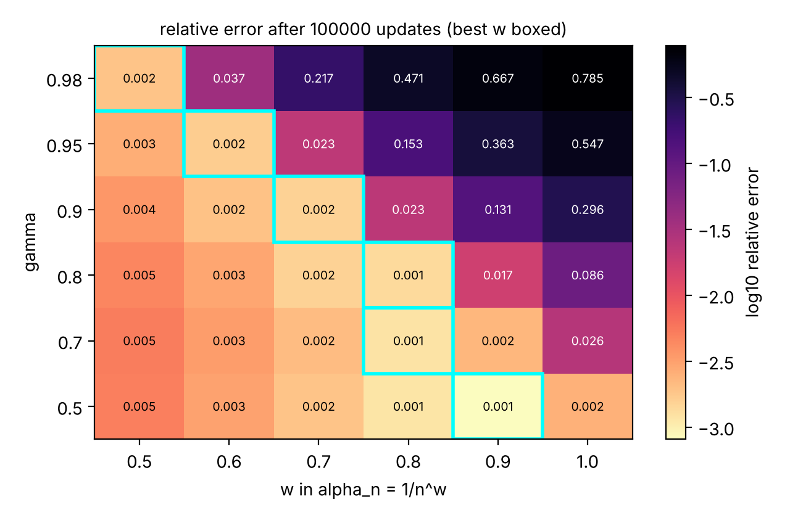
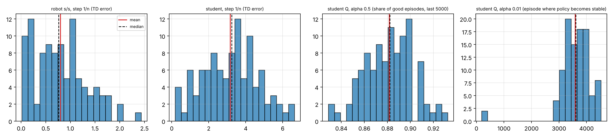

# rl-projet-m2
Reinforcement learning course project: Poisson bandits (ETC, decaying ε-greedy), green robot and student dilemma MDPs (policy iteration, Monte Carlo, TD(0), Q-learning).

Done in pair by Yaxin ZHENG and Lu ZHAI. The code comments and the report are in French.

## A few pictures

Some plots from the project and from the follow-up. Click on one to see it bigger.

<p align="center">
  <a href="figures/ex24_regret.png"></a>
  <a href="figures/ex32_qlearning.png"></a>
</p>

*Left: the regret of ETC(3) goes up in a straight line at the end, a few runs just stay on the wrong machine until the end. Right: Q-learning on the student dilemma, with alpha = 0.01 the policy is wrong for ~3500 episodes and then never moves again.*

<p align="center">
  <a href="research/figures/steps_phase.png"></a>
</p>

*This is my favourite one. With a step c/n, TD(0) is supposed to converge like n^-min(c(1 - gamma), 1/2). The red dots are the slopes we measured, the dashed line is the theory. For c = 1 (the usual 1/n) you are stuck at n^-0.2, that's why it looked so slow in the report.*

<p align="center">
  <a href="research/figures/bandits_long.png"></a>
  <a href="research/figures/steps_omega.png"></a>
</p>

*Left: KL-UCB and Thompson sampling up to one million pulls. Both stay under the Lai-Robbins line C log n, which looks like cheating but is just a big negative offset, the slopes do go to C. Right: which exponent w to use for a step 1/n^w, the longer the horizon the smaller w should be.*

<p align="center">
  <a href="research/figures/seeds_shapes.png"></a>
</p>

*Same experiments as the report, on 100 seeds. Some numbers we wrote with one seed are all over the place (first panel goes from 0.02 to 2.4).*

## What is inside

```
code/
  ex24_bandits.py    # Poisson bandits P(2), P(3), P(4) : ETC(m) for m = 3, 5, 10 and eps_n-greedy
  ex31_robot.py      # green robot : policy iteration, Monte Carlo, TD(0), MC eps-greedy control
  ex32_etudiant.py   # student dilemma : TD(0) for the policy SWWS, Q-learning
figures/             # all the plots made by the scripts
resultats/           # the numbers (json) used in the report
rapport/             # the report (LaTeX source + pdf)
extensions/          # some extra experiments we did after the project (see below)
research/            # a longer follow-up written like a small research note (English, with a pdf)
```

## How to run

```
pip install -r requirements.txt
cd code
python ex24_bandits.py
python ex31_robot.py
python ex32_etudiant.py
```

No window will open, the figures are saved in `figures/` and the numbers are printed and saved in `resultats/`.
The seeds are fixed so you should get exactly the same numbers as in the report. Each script take less than 15 s on a laptop.

## Main results

- **Bandits (n = 1000, 100 runs)** : more exploration was better here. ETC(10) ends on the best machine in 97 runs out of 100, ETC(3) only in 88 (the other runs stay stuck, so the regret grows linearly). eps_n-greedy with c = 1 gets 94/100 with a regret close to ETC(5).
- **Green robot** : the optimal policy is search when high / recharge when low, with v* = (16.03, 12.82). Monte Carlo and TD(0) find the exact values, the step 1/n is too slow in practice. With the "immediate reward" version of online MC you get the myopic policy search/wait, with the real discounted return you get search/recharge.
- **Student dilemma** : the optimal policy is W/W/W/R (SWWS only differs in state 1). With the seed of the report, Q-learning finds it for alpha = 0.5, 0.1 and 0.01, but with alpha = 0.01 it needs around 3500 episodes before the greedy policy becomes right.

## Going further

After the project we tried to answer three questions that stayed open in the report. Everything is in [`extensions/`](extensions/README.md) (notes in French):

1. **Bandits** : UCB, KL-UCB and Thompson sampling on a longer horizon (n = 100 000), compared with the Lai-Robbins lower bound. KL-UCB ends very close to the theoretical constant (10.2 vs 10.56) and no run stays stuck, unlike ETC.
2. **Why the step 1/n was so slow** : with gamma = 0.8 the initial error only decrease like n^(-0.2). Using 5/(n+4) or 1/n^0.8 instead divides the TD(0) error by about 100 on the robot.
3. **30 seeds instead of 1** : most conclusions of the report hold, but Q-learning with alpha = 0.5 only ends on the optimal policy in 25 seeds out of 30.

Later I went back to the same three questions more seriously and wrote it up as a short note, [**Loose ends of a small RL project**](research/paper/main.pdf). The summary is in [`research/`](research/README.md).

---

**P.S.** Honestly, the whole follow-up started because of one number. In the report, TD(0) with the step 1/n still had an error of 1.28 after 100 000 updates and we just wrote "too slow in practice" and moved on. It kept bothering me. In the end it is exactly n^-0.2, there was nothing wrong in our code, it is just what 1/n does when gamma = 0.8. I really did not expect the dots to fall on the line like in the plot above.

Thanks to Lu for doing the project with me. And if you are taking the same course: in the student dilemma, state 4 with action W gives -1000, so don't let your epsilon-greedy walk in there too often :)
