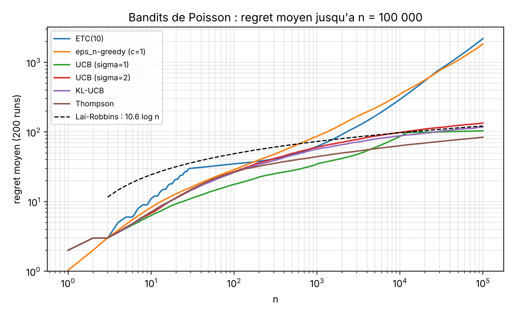
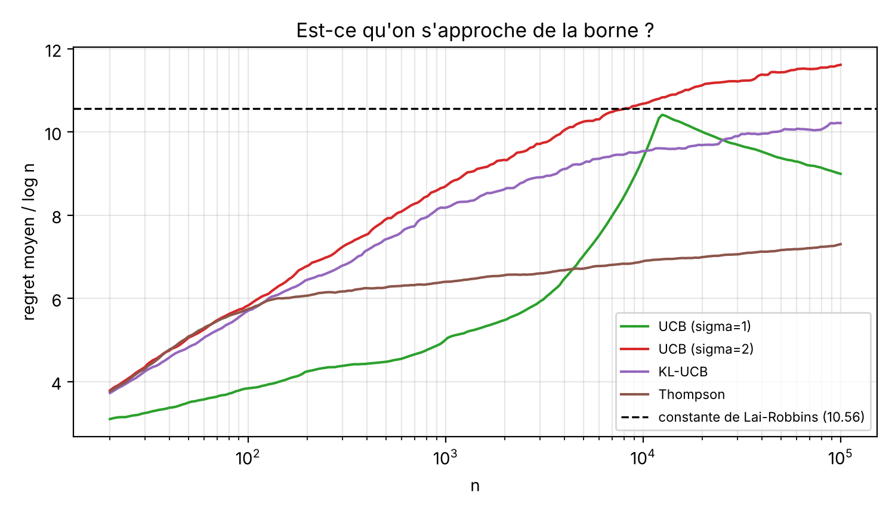
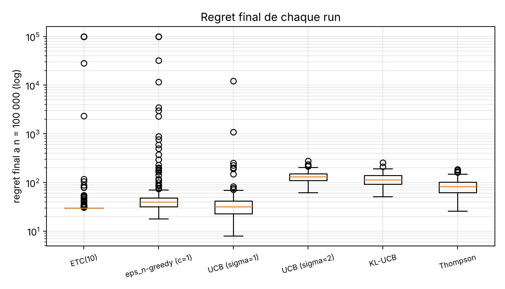
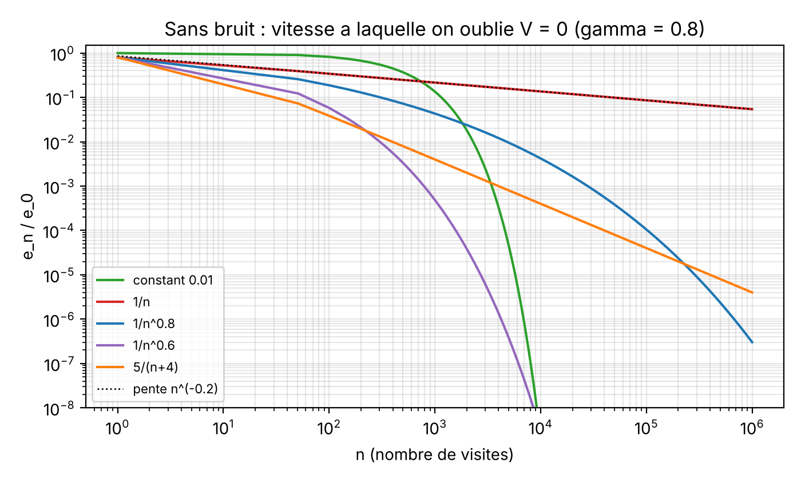
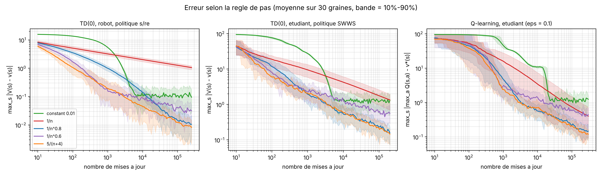
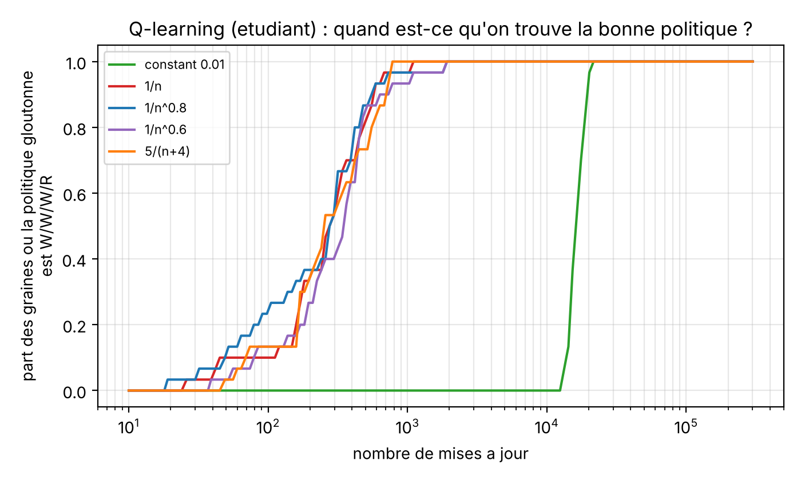
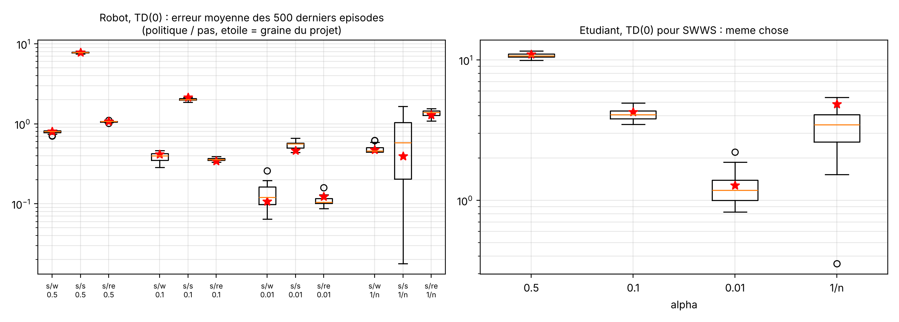
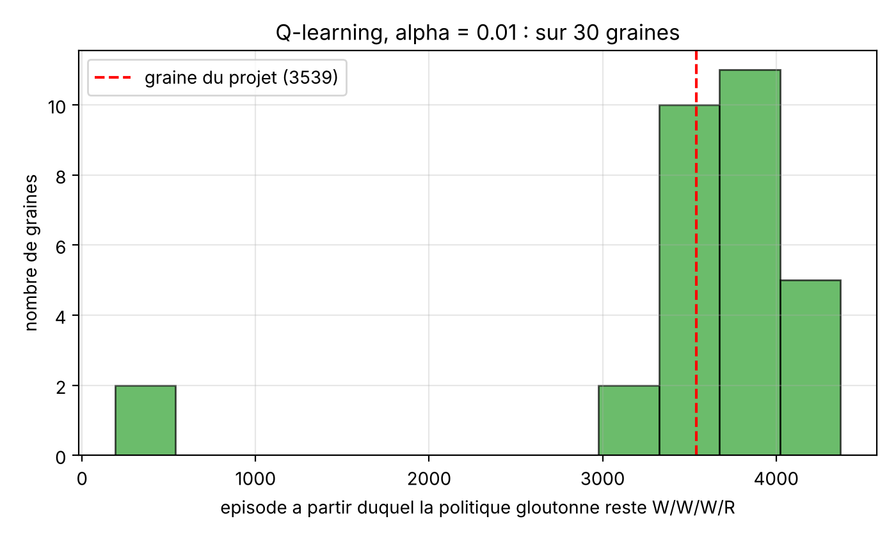

# Pour aller un peu plus loin

Après avoir rendu le projet, il restait trois questions qu'on avait laissées ouvertes dans le rapport. On a voulu les creuser un peu, juste pour comprendre. Tout est dans ce dossier et les scripts réutilisent directement le code du projet (dossier `code/`), donc c'est bien le même modèle et les mêmes fonctions.

| script | question | durée |
|---|---|---|
| `bandits_ucb.py` | Est-ce qu'on peut faire mieux que ETC et εₙ-greedy pour les bandits de Poisson ? | ~1 min |
| `pas_apprentissage.py` | Pourquoi le pas 1/n était si lent pour TD(0), et comment le corriger ? | ~1 min |
| `graines.py` | Est-ce que les résultats de 3.1 et 3.2 tiennent si on change la graine ? | ~2 min |

Les figures vont dans `figures/` et les chiffres dans `resultats/`. Les graines sont fixées.

---

## 1. Bandits : UCB, KL-UCB, Thompson et la borne de Lai-Robbins

Dans le projet on avait n = 1000 et on avait vu que ETC(3) n'est pas sous-linéaire : quelques essais restent bloqués sur la machine 2. Ici on prend un horizon beaucoup plus long (n = 100 000, 200 runs) et on ajoute trois algorithmes classiques qu'on n'avait pas dans le cours :

**UCB** joue la machine qui maximise $\hat\mu_k + \sqrt{2\sigma^2 \log t / N_k}$. Le problème c'est qu'il faut choisir σ, et pour une loi de Poisson la variance est égale à la moyenne (donc entre 2 et 4 ici, pas 1). On a essayé σ = 1 (le choix "naïf") et σ = 2 (variance 4, la plus grande).

**KL-UCB** remplace le terme en racine par la vraie divergence de Kullback-Leibler entre deux lois de Poisson, qui a une formule simple : $\mathrm{KL}(\mathcal P(p)\,\|\,\mathcal P(q)) = p\log(p/q) + q - p$. L'indice est le plus grand q tel que $N_k\,\mathrm{KL}(\hat\mu_k, q) \le \log t$, on le trouve par dichotomie.

**Thompson sampling** : on met un prior de Jeffreys sur chaque λ, et comme la loi Gamma est conjuguée avec la loi de Poisson, la loi a posteriori est juste $\mathrm{Gamma}(0{,}5 + S_k,\ N_k)$ (S_k = somme des récompenses de la machine k). À chaque tour on tire un λ dans chaque posterior et on joue le plus grand.

### La borne de Lai-Robbins à la main

Pour un algorithme "raisonnable" (qui marche bien sur tous les problèmes), le regret vérifie asymptotiquement
$$\liminf_n \frac{R_n}{\log n} \ \ge\ \sum_{k:\Delta_k>0} \frac{\Delta_k}{\mathrm{KL}(\mathcal P(\mu_k)\,\|\,\mathcal P(\mu^*))}.$$
Ici KL(P(2) ‖ P(4)) = 2 log(1/2) + 2 ≈ 0,614 et KL(P(3) ‖ P(4)) = 3 log(3/4) + 1 ≈ 0,137, donc la constante vaut 2/0,614 + 1/0,137 ≈ 3,26 + 7,30 = **10,56**. C'est surtout la machine 2 qui coûte : elle est proche de la meilleure, donc dure à distinguer.

### Résultats

| algorithme | regret moyen à n = 1000 | regret moyen à n = 10⁵ | médiane | pire run | runs bloqués* | regret / log n |
|---|---|---|---|---|---|---|
| ETC(10) | 61,9 | 2184,4 | 30,0 | 100 000 | 2,5 % | 189,7 |
| εₙ-greedy (c = 1) | 86,6 | 1821,3 | 39,5 | 100 008 | 2,5 % | 158,2 |
| UCB (σ = 1) | 34,6 | 103,5 | 32,0 | 12 206 | 0,5 % | 9,0 |
| UCB (σ = 2) | 60,0 | 133,7 | 131,5 | 278 | 0 | 11,6 |
| KL-UCB | 56,5 | 117,6 | 114,5 | 254 | 0 | 10,2 |
| Thompson | 44,2 | 84,1 | 82,5 | 187 | 0 | 7,3 |

\* regret final > 10 000, c'est-à-dire qu'il est resté longtemps sur une mauvaise machine.

Pour ETC(10) et εₙ-greedy, la médiane est toute petite (30 pour ETC(10), c'est exactement le coût de l'exploration 3m = 30), mais 5 runs sur 200 restent bloqué longtemps sur la machine 2 (4 jusqu'à la fin pour ETC(10), 3 pour εₙ-greedy). Ces 5 runs font presque tout le regret moyen, et on voit bien sur la figure que la courbe moyenne finit par monter en ligne droite. C'est le même phénomène que dans le projet, mais avec n = 1000 on le voyait moins.

Le cas qui nous a le plus surpris c'est UCB avec σ = 1. Sa médiane (32) est presque la meilleure du tableau, seul ETC(10) fait un peu mieux (30), et il fait même mieux que la "borne" de Lai-Robbins. En fait c'est pas une contradiction : la borne ne s'applique qu'aux algorithmes qui marchent sur tous les problèmes, et UCB avec σ = 1 est trop confiant pour des lois de Poisson (sa vraie variance est 2 à 4). Il explore moins, donc il gagne la plus part du temps, mais de temps en temps il se trompe et met très longtemps à corriger : un run a un regret de 12 206. Sur un autre problème (variance plus grande, gaps plus petits) ça pourrait être bien pire.

On peut d'ailleurs retrouver les médianes de UCB à la main. UCB joue une mauvaise machine k environ $2\sigma^2\log n/\Delta_k^2$ fois, donc le regret vaut à peu près $\sum_k 2\sigma^2 \log n/\Delta_k = 2\sigma^2(1/2 + 1)\log n = 3\sigma^2\log n$. Avec log(10⁵) ≈ 11,5 ça donne 34,5 pour σ = 1 (on observe une médiane de 32) et 138 pour σ = 2 (on observe 131,5). C'est assez interessant de voir que la formule marche aussi bien.

KL-UCB est le seul qui n'a besoin de rien régler, il utilise juste la bonne KL. Son regret divisé par log n vaut 10,2 à la fin, très proche de la constante 10,56 : c'est ce que dit la théorie (KL-UCB est asymptotiquement optimal pour ce genre de lois, Cappé et al. 2013). Thompson est encore plus bas (7,3) et c'est le meilleur en moyenne. Être sous la constante n'est pas un problème non plus : la borne est seulement asymptotique et on voit sur la figure que le rapport de Thompson continue à monter doucement.

Ce qu'on retient : à n = 1000, l'horizon du projet, le gain n'est pas énorme (ETC(10) fait 61,9, KL-UCB 56,5). La vraie différence c'est la robustesse. Avec UCB (σ = 2), KL-UCB ou Thompson aucun run ne reste bloqué, et l'écart-type du regret final est d'environ 30 au lieu de plus de 10 000. Sur ce problème Thompson est le meilleur compromis. Bien sûr on n'a testé qu'un seul problème (2, 3, 4).

---

## 2. Pourquoi le pas 1/n est si lent

Dans le rapport on avait juste constaté que le pas 1/n est trop lent, sans vraiment l'expliquer. En fait on peut le voir avec un calcul très simple.

Prenons un seul état qui reboucle sur lui-même avec une récompense r et sans hasard. La vraie valeur est v = r/(1 − γ), et si on note $e_n = v - V_n$ l'erreur après n mises à jour TD(0), on trouve directement
$$e_n = \big(1 - (1-\gamma)\,\alpha_n\big)\, e_{n-1}.$$
Avec $\alpha_n = 1/n$ ça donne $e_n = e_0 \prod_{k\le n}(1 - (1-\gamma)/k) \approx e_0\, n^{-(1-\gamma)}/\Gamma(\gamma)$. Pour γ = 0,8 l'erreur décroît donc comme $n^{-0{,}2}$, c'est extrêmement lent : après 100 000 visites il reste encore 8,6 % de l'erreur de départ. Pour le robot (politique s/re) on part de V = 0 et v(high) = 16,03, donc il resterait une erreur d'environ 1,4. C'est à peu près ce qu'on avait dans le rapport (1,28), et la moyenne sur 30 graines est 1,37.

L'idée derrière : avec 1/n, V est juste la moyenne de toutes les cibles depuis le début, et les premières cibles ont été calculées avec un V faux (= 0). Elles ne sont jamais oubliées, seulement diluées, et en plus chaque nouvelle cible réutilise ce V faux (le facteur γ). Si γ était 0, 1/n serait parfait. Plus γ est proche de 1, pire c'est. C'est un résultat connu : Szepesvári (1997) montre ce genre de vitesse en $1/t^{R(1-\gamma)}$ pour Q-learning, et Even-Dar & Mansour (2003) montrent qu'avec 1/n il faut un temps exponentiel en 1/(1 − γ), alors qu'avec un pas $1/n^\omega$, ω ∈ (1/2, 1), c'est seulement polynomial.

Deux façons de corriger. La première, c'est $\alpha_n = c/(n + c - 1)$ avec c = 1/(1 − γ) = 5, ce qui donne ici $\alpha_n = 5/(n+4)$. Le produit se calcule exactement parce qu'il télescope : $\prod_{k\le n}\big(1 - \tfrac{1}{k+4}\big) = \prod_{k\le n} \tfrac{k+3}{k+4} = \tfrac{4}{n+4}$, donc l'erreur décroît en 1/n au lieu de $n^{-0{,}2}$. La deuxième, c'est un pas polynomial $1/n^\omega$ : le biais disparaît alors très vite (comme $\exp(-(1-\gamma)n^{1-\omega}/(1-\omega))$), mais le bruit reste de l'ordre de $\sqrt{\alpha_n} = n^{-\omega/2}$, donc si ω est trop petit c'est bruité. Le pas constant, lui, oublie le biais très vite mais le bruit ne disparaît jamais (c'est le "plateau" du rapport).

On a testé tout ça sur les trois expériences du projet, avec 30 graines à chaque fois :

| erreur finale (moyenne ± écart-type) | TD(0), robot s/re (250 000 MAJ) | TD(0), étudiant SWWS (200 000 MAJ) | Q-learning, étudiant (300 000 MAJ) |
|---|---|---|---|
| constant 0,01 | 0,095 ± 0,055 | 1,30 ± 0,66 | 1,24 ± 0,65 |
| 1/n | 1,06 ± 0,13 | 1,34 ± 0,58 | 0,40 ± 0,32 |
| 1/n^0,8 | 0,011 ± 0,007 | 0,156 ± 0,071 | 0,146 ± 0,064 |
| 1/n^0,6 | 0,032 ± 0,021 | 0,56 ± 0,24 | 0,45 ± 0,18 |
| 5/(n+4) | **0,008 ± 0,005** | **0,145 ± 0,053** | **0,119 ± 0,042** |

(pour Q-learning l'erreur est $\max_s |\max_a Q(s,a) - v^*(s)|$)

Le résultat est assez net : en changeant seulement la règle de pas, l'erreur du robot est divisée par plus de 100 par rapport à 1/n, et par 10 par rapport au meilleur pas constant du projet. 5/(n+4) et 1/n^0,8 sont les deux meilleurs partout, 1/n^0,6 est plus bruité comme prévu. Pour Q-learning, une remarque : toutes les règles décroissantes trouvent la politique W/W/W/R après 1000 à 2000 mises à jour (le pas constant 0,01 en met environ 20 000). La lenteur de 1/n se voit sur la précision des valeurs, pas sur la politique.

---

## 3. Les mêmes expériences avec 30 graines

C'était la limite qu'on avait écrite dans la conclusion. `graines.py` relance exactement les expériences du projet (mêmes fonctions, mêmes paramètres, même ordre) avec les graines 1 à 30. On a vérifié d'abord qu'avec les graines du projet (31 et 32) on retombe sur les mêmes chiffres que dans le rapport, sinon la comparaison ne voudrait rien dire.

### Robot (exercice 3.1)

Erreur de TD(0) moyennée sur les 500 derniers épisodes, moyenne ± écart-type sur 30 graines (entre parenthèses la valeur du rapport) :

| pas η | s/w | s/s | s/re |
|---|---|---|---|
| 0,5 | 0,79 ± 0,03 (0,80) | 7,82 ± 0,15 (7,77) | 1,07 ± 0,02 (1,08) |
| 0,1 | 0,39 ± 0,05 (0,42) | 2,02 ± 0,08 (2,14) | 0,36 ± 0,02 (0,34) |
| 0,01 | 0,13 ± 0,05 (0,11) | 0,55 ± 0,06 (0,46) | 0,11 ± 0,01 (0,12) |
| 1/n | 0,48 ± 0,05 (0,47) | 0,64 ± 0,51 (0,39) | 1,37 ± 0,12 (1,28) |

Les conclusions du rapport tiennent : en moyenne η = 0,01 est le meilleur pour les trois politiques et s/s reste la plus difficile. La seule case vraiment instable c'est 1/n pour s/s, qui va de 0,02 à 1,65 selon la graine. Avec 1/n les premières pannes pèsent très lourd et pour toujours (voir la partie 2), donc tout dépend de quand elles arrivent. Le 0,39 du rapport n'était pas très représentatif.

Pour Monte-Carlo on a regardé si la vraie valeur tombe bien dans l'intervalle de confiance à 95 %. Dans 5 cas sur 6 c'est correct, entre 87 % et 100 % selon le cas (142 fois sur 150 en tout, soit 94,7 %, avec 30 graines on ne peut pas être plus précis). Mais pour s/w en partant de low, c'est **0 sur 30**. Ce n'est pas un bug : ce retour n'a aucun hasard, donc l'écart-type est nul et l'intervalle a une largeur 0. Et comme on coupe à T = 60 pas, on trouve $5(1 - 0{,}8^{60}) = 5 - 7{,}7\times10^{-6}$ au lieu de 5. L'intervalle oublie le biais de troncature. Dans le rapport on avait écrit 5,00 ± 0,00, ce qui reste vrai à deux décimales.

Pour le contrôle MC ε-greedy, les 30 graines trouvent s/re avec le vrai retour, et les 30 trouvent s/w avec la "récompense immédiate" du poly. Donc la petite histoire du rapport est robuste. Les Q estimés bougent très peu d'une graine à l'autre (écart-type au plus 0,15).

### Étudiant (exercice 3.2)

Pour TD(0) avec SWWS, l'erreur moyenne vaut 10,72 ± 0,41 pour α = 0,5 (rapport : 10,94), 4,12 ± 0,36 pour α = 0,1 (4,27), 1,25 ± 0,33 pour α = 0,01 (1,28) et 3,28 ± 1,16 pour 1/n (4,83). Là aussi 1/n est le plus dépendant de la graine et notre graine était plutôt du mauvais côté.

Pour Q-learning il y a deux choses à corriger dans le rapport. D'abord on avait écrit que les trois valeurs de α donnent à la fin la politique W/W/W/R. C'est vrai pour α = 0,1 et α = 0,01 (30 graines sur 30), mais pour α = 0,5 seulement **25 graines sur 30** finissent sur la bonne politique, et en moyenne la politique gloutonne est bonne dans 88 % des 5000 derniers épisodes. Avec α = 0,5 il faut plutôt dire "la plus part du temps".

Ensuite on avait dit que Q(2, R) est mal estimé (10,3 au lieu de 15,29) parce que cette action est rarement jouée. L'explication est bonne mais l'ampleur était de la malchance : sur 30 graines on trouve 14,3 ± 1,3, et notre 10,3 est plus bas que toutes les 30 graines.

Enfin, pour α = 0,01, l'épisode à partir duquel la politique devient bonne et ne bouge plus est en médiane environ 3770 (le rapport disait environ 3539, donc c'est typique). Sauf deux graines chanceuse où c'est avant 600 épisodes : l'exploration a fait remonter la récompense de 100 plus tôt.

---

### Références

O. Cappé, A. Garivier, O.-A. Maillard, R. Munos, G. Stoltz (2013). *Kullback-Leibler upper confidence bounds for optimal sequential allocation*. Annals of Statistics.

N. Korda, E. Kaufmann, R. Munos (2013). *Thompson sampling for 1-dimensional exponential family bandits*. NIPS.

T. L. Lai, H. Robbins (1985). *Asymptotically efficient adaptive allocation rules*. Advances in Applied Mathematics.

E. Even-Dar, Y. Mansour (2003). *Learning rates for Q-learning*. JMLR.

C. Szepesvári (1997). *The asymptotic convergence-rate of Q-learning*. NIPS.
