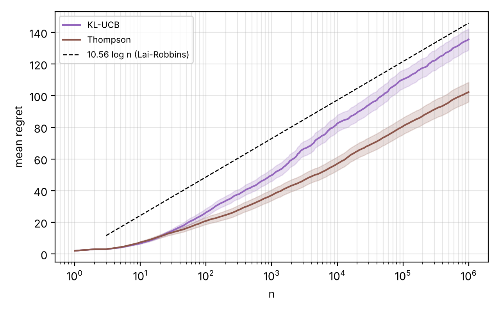
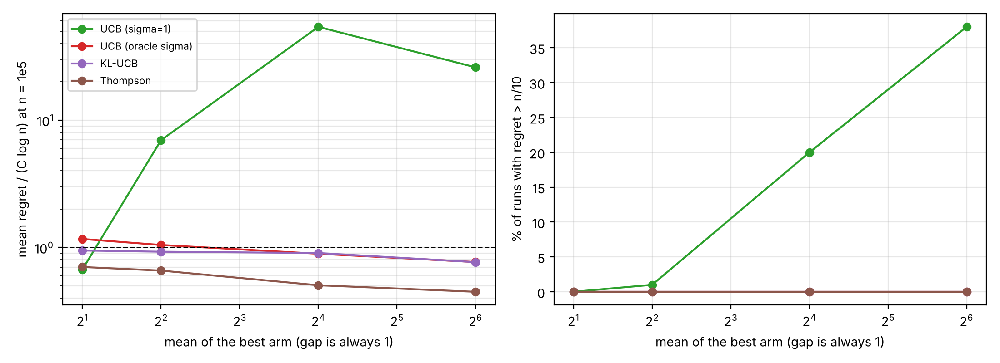
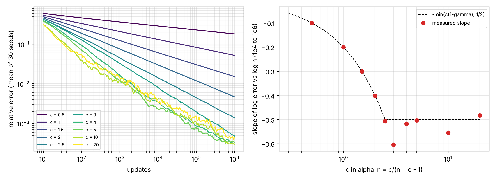
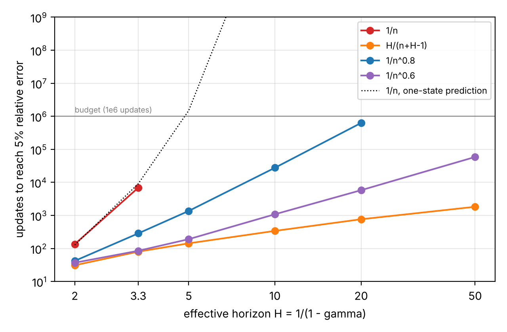
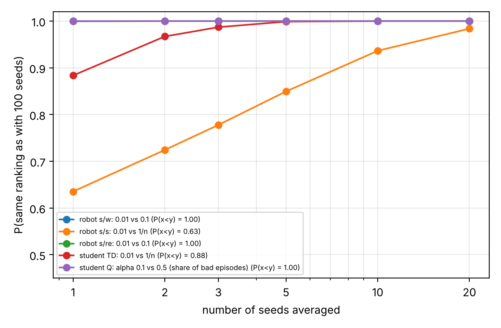

# Loose ends of a small RL project

This folder is a follow-up of the course project. When we wrote the report we left three things a bit unexplained, so I went back to them and tried to do it more seriously, like a small research note. The write-up is [`paper/main.pdf`](paper/main.pdf) (about 12 pages, in English). This page is the short version.

## 1. Poisson bandits and the Lai-Robbins constant

On the project instance (arms with means 2, 3, 4) the lower bound constant is C = 10.56. I ran KL-UCB and Thompson sampling up to one million pulls (100 runs). Both end *under* the line C log n, which looks wrong at first. It is not: the regret is roughly a log n + b with a big negative b, so the ratio R_n / log n is not the right thing to look at. The slope measured decade by decade goes down to C for KL-UCB (14.3, 12.4, 11.35) and up to it for Thompson (8.4, 10.0, 9.5).



Then a two-armed family (mu - 1, mu) with mu = 2, 4, 16, 64: same gap, bigger and bigger variance. UCB with a fixed sigma = 1 has the best median regret everywhere (around 20, way under the bound), but it gets stuck on the bad arm in 0%, 1%, 20% and 38% of runs. That is the price the Lai-Robbins bound talks about. KL-UCB and Thompson never get stuck and don't need to know the variance.



## 2. Why the step 1/n is so slow

With one state and no noise, TD(0) with step 1/n forgets the initial error like n^-(1 - gamma), so n^-0.2 for gamma = 0.8. That explains almost exactly the error we saw in the report (predicted about 1.4, measured 1.28). With noise, stochastic approximation says the error goes like n^-min(c(1 - gamma), 1/2) for a step c/n, and the measured slopes match to two decimals up to c = 2.5:



When gamma goes to 1 the cost of 1/n explodes (never reaches 5% error for gamma >= 0.8 within 1e6 updates), with c = 1/(1 - gamma) the cost only grows like H^1.25, and for steps 1/n^w the best w goes down from 0.9 (gamma = 0.5) to 0.5 (gamma = 0.98).



## 3. One seed or a hundred

I reran exactly the experiments of the report (same functions, same order of random draws) on seeds 1 to 100, and went through the report sentence by sentence. Out of 14 claims we could check on one run, 7 hold on (almost) every seed, 5 hold on 80 to 89 seeds, and 2 were mostly luck:

- "Q(2, R) is clearly underestimated with alpha = 0.01": true on 7 seeds out of 100. Our seed gave the lowest value of all 100.
- "eta = 0.01 is the best step for s/s": true on 63 seeds. The seed of the report was actually one of the 37 where it is false, we just did not see it.

The "Q-learning with alpha = 0.5 ends on the optimal policy" sentence is true on 89 seeds, and that is not really noise: the policy keeps switching and is right 88% of the time, so the last episode is just one draw of that coin. For the comparisons, how many seeds you need is basically decided by P(X < Y): when it is 1, one seed is enough, when it is 0.63 you need around 20 seeds to get the ranking right 98% of the time.



## How to run

Everything reuses the project code in `../code` (and `../extensions/graines.py` for the seeds part), so the models and the algorithms are exactly the ones of the report.

```
cd research
python bandits.py long     # KL-UCB and Thompson up to n = 1e6        (~10 min)
python bandits.py scale    # two-armed family (mu - 1, mu)            (~4 min)
python step_sizes.py       # the three step-size experiments          (~3 min)
python seeds.py            # 100 seeds of the report experiments      (~5 min on 2 cores)
cd paper && pdflatex main.tex && pdflatex main.tex
```

Figures go in `figures/`, numbers in `results/`. All seeds are fixed, so you should get the same numbers as in the note.
